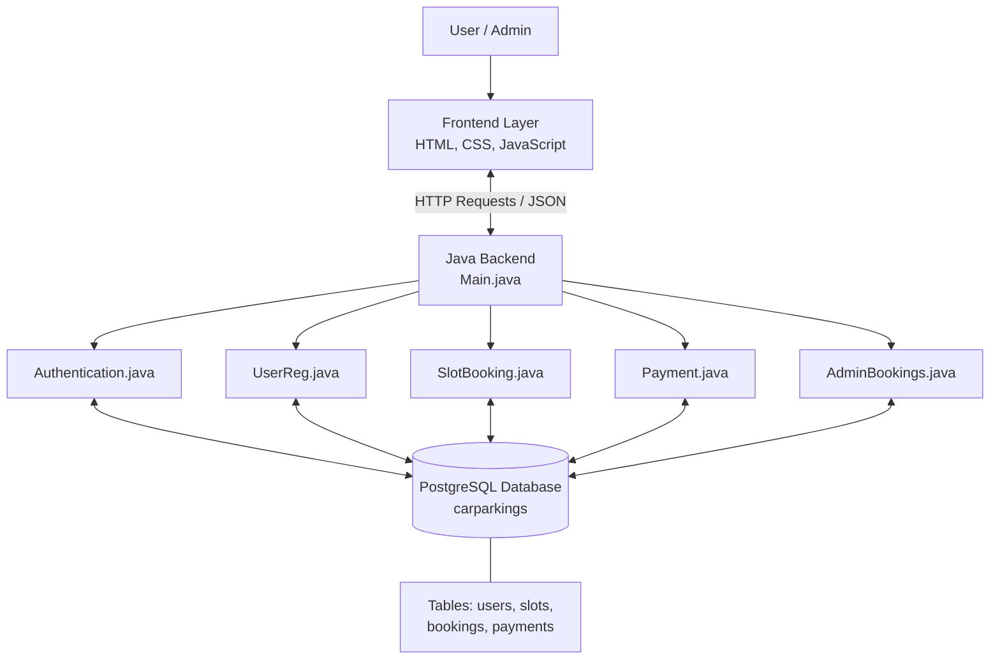

## System Architecture

ParkEasy follows a three-layer architecture consisting of the presentation layer, application layer, and data layer.

### Architecture Layers

1. **Presentation Layer:** Provides registration, login, parking slot booking, booking history, and admin pages using HTML, CSS, and JavaScript.
2. **Application Layer:** Java handles API requests, authentication, user registration, slot booking, payment logic, and admin booking records.
3. **Data Layer:** PostgreSQL stores user details, parking slots, bookings, and payment records.

### Technology Stack

| Component | Technology |
|---|---|
| Frontend | HTML, CSS, JavaScript |
| Backend | Java |
| Database | PostgreSQL |
| Database Connectivity | JDBC |
| Communication | HTTP and JSON |

**Data flow:** User/Admin → Frontend → Java Backend → PostgreSQL → Response to Frontend.

*Note: The payment component represents the project's implemented payment logic; it does not imply integration with a live payment gateway.*
